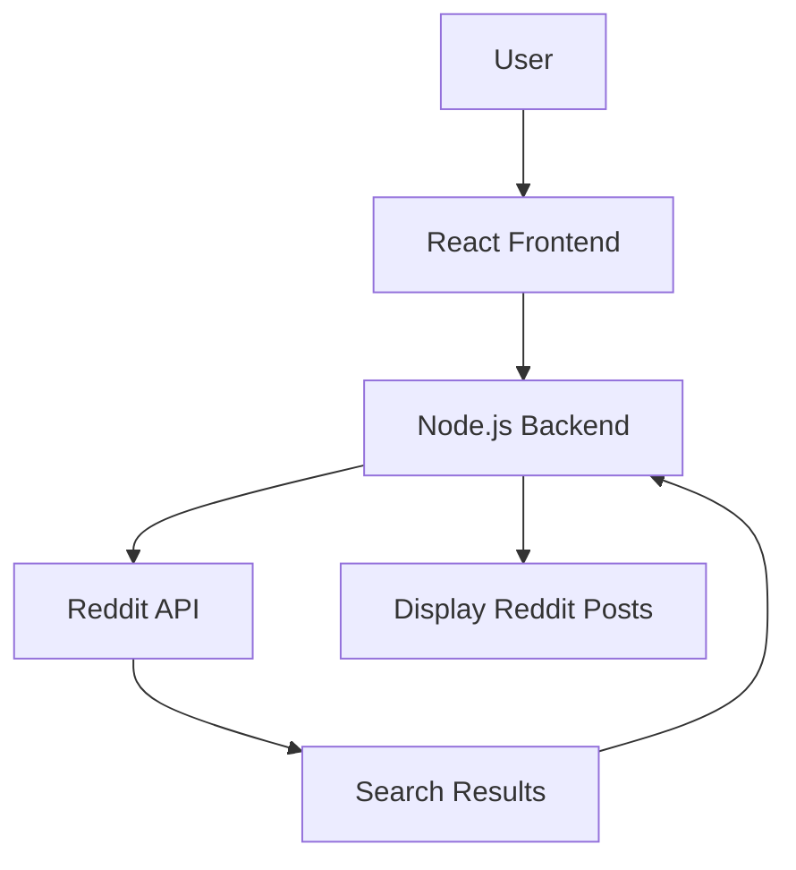

# 🔍 Reddit Search App

## 📌 Project Overview

Reddit Search App is a full-stack web application that allows users to search and explore Reddit posts using keywords. The application integrates the Reddit API to retrieve relevant posts and display them through a clean and user-friendly interface.

The project demonstrates full-stack development, external API integration, asynchronous data fetching, and dynamic content rendering.

## 🎯 Objectives

- Simplify the process of searching Reddit posts.
- Retrieve relevant information using keyword-based searches.
- Demonstrate frontend and backend integration.
- Provide an interactive and user-friendly search experience.

## ✨ Key Features

- **Keyword-Based Search:** Search Reddit posts using specific keywords.
- **Reddit API Integration:** Fetch relevant posts directly from Reddit.
- **Dynamic Content Rendering:** Display search results dynamically using React.js.
- **Card-Based Interface:** Present Reddit posts in an organized and readable format.
- **Backend Integration:** Handle API requests through a Node.js backend.
- **User-Friendly Interface:** Provide a simple and intuitive browsing experience.

## 🛠️ Tech Stack

| Component | Technologies |
|---|---|
| Frontend | React.js |
| Backend | Node.js |
| Programming Language | JavaScript |
| Styling | HTML, CSS |
| External API | Reddit API |
| Communication | REST API |
| Version Control | Git, GitHub |
| Development Environment | Visual Studio Code |

## ⚙️ System Architecture

## 🔄 Working Principle

1. The user enters a keyword in the search bar.
2. The React frontend sends the search request to the Node.js backend.
3. The backend communicates with the Reddit API.
4. The Reddit API retrieves relevant posts.
5. The backend returns the retrieved data to the frontend.
6. The search results are dynamically displayed in a card-based layout.

## 💡 Applications

- Online content discovery.
- Social media research.
- Community discussion exploration.
- Topic-based information retrieval.
- Reddit content analysis.

## 📚 Learning Outcomes

- Full-stack web application development.
- REST API integration.
- React component-based architecture.
- Client-server communication.
- Asynchronous programming.
- Dynamic data rendering.
- Handling JSON responses.

## 🚀 Future Enhancements

- Subreddit-based filtering.
- Sorting posts by popularity and date.
- Dark mode support.
- Search history management.
- Bookmarking favorite posts.
- AI-powered sentiment analysis of Reddit posts.
- Trending topic visualization.

## 👩‍💻 Developer

**Kiruthika Loganathan**

- B.Tech – Artificial Intelligence and Data Science
- KPR Institute of Engineering and Technology
- GitHub: [kiruthika569](https://github.com/kiruthika569)

---

⭐ If you find this project useful, consider giving the repository a star!

**Reddit Search App – Explore, Search and Discover Reddit Content Easily.**
